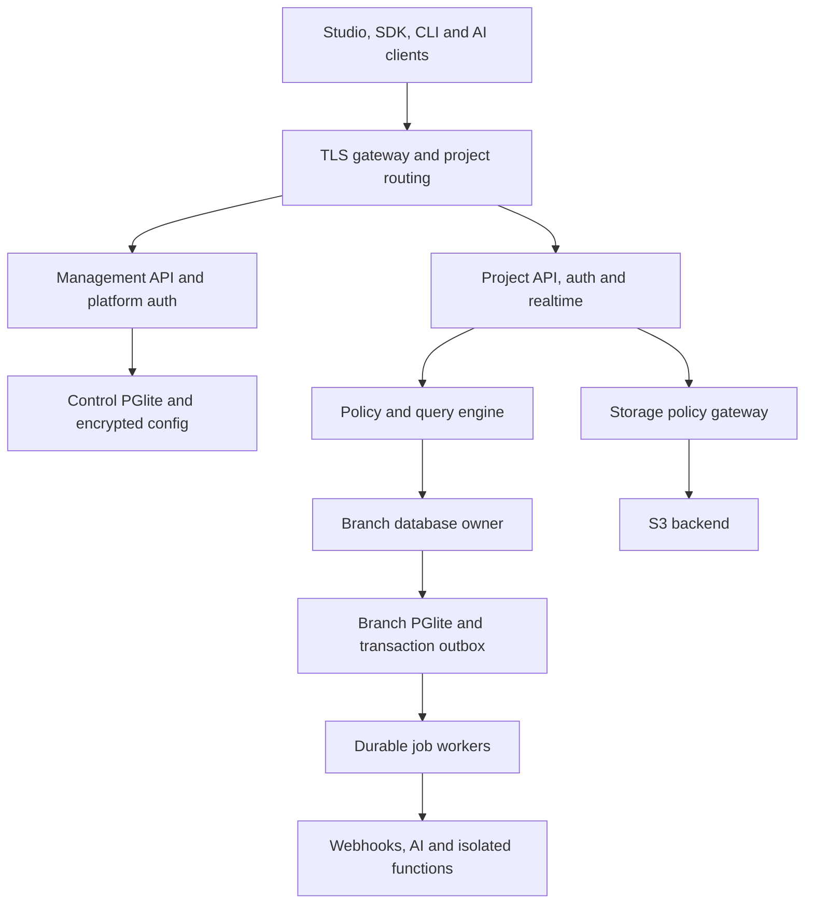

export const frontmatter = {"title":"Complete development specification","description":"Specification 1.1: expanded-release requirements, architecture and acceptance traceability; not feature availability.","section":"Reference","slug":"reference/development-spec","order":90};

# Complete development specification

Specification version: **1.1** • Date: 6 October 2026 • Product version: **0.1.0**

Status: expanded release under development; not a declaration of feature availability.

**Precedence:** Sections 31–37 define the accepted expanded release and supersede conflicting phase assignments in sections 1–30. Earlier sections retain architectural history and deferred product ideas. The release is incomplete until every expanded requirement has passing acceptance evidence. See [implementation status](/docs/roadmap/expanded-release).

## 1. Product definition

QB Flex is a lightweight, self-hostable Backend as a Service for small applications, prototypes, internal tools, and early-stage products. It combines PGlite databases, generated APIs, authentication, realtime, storage, functions, and AI tooling behind a dark monochrome Studio.

The product should offer the convenience of Supabase while using Bun and PGlite as its core. It is a separate platform with its own APIs, SDK, CLI, and security semantics. Supabase interoperability is an explicitly scoped adapter project; neither its CLI nor its PostgreSQL wire protocol works automatically with QB Flex.

**Primary goals:** provision a project in minutes; create tables visually or through migrations; generate typed REST and GraphQL access; protect every user-facing data path; provide straightforward backups and local development; keep a single-node installation operationally small.

**Initial scale assumptions:** one writable PGlite database per project branch, local persistent SSD, one active database owner per branch, bounded write workloads, and one primary region. Higher traffic is addressed through independent project placement, read scaling, and quotas rather than simultaneous owners of one database directory.

**Terminology:** an organization owns projects; a project owns branches; each branch is an isolated database environment. Platform operators and project developers are control-plane identities. Application end users belong to a project authentication realm. A project (organization) role is not an application user role. Application users may be assigned branch-scoped named roles used by Database policies alongside the fixed credential classes anonymous/authenticated/service.

### 1.1 Release scope

- **P0 — foundation/MVP:** organizations, projects, primary branches, PGlite lifecycle, migrations, table editor, generated REST, application RLS, email/password auth, initial social providers, realtime row events, basic S3 storage, TypeScript SDK, CLI, audit logs, backups.
- **P1 — complete small-project BaaS:** GraphQL, magic links/OTP, 20+ certified social connectors, phone auth, CAPTCHA, webhooks, presence/broadcast/binary channels, resumable uploads, image transforms, snapshot branching, AI inference/vector search, isolated Bun functions, hosted MCP.
- **P2 — advanced platform:** SSO, OAuth identity provider, read replicas, CDN integration, analytics buckets, RAG workflows, Deno functions, regional placement, Terraform provider, advanced Studio assistant.

These are delivery phases, not removal of requested scope. Feature flags and the Management API must expose availability and experimental status accurately.

## 2. Feature coverage and PGlite adaptation

| Requested feature | QB Flex implementation | Phase / qualification |
| --- | --- | --- |
| Full PGlite database | PostgreSQL SQL, transactions, indexes, triggers, views, full-text/vector APIs remain planned; owner SQL console | P0; API exposure is a supported subset |
| Auto REST API | Schema registry generates validated CRUD/query routes | P0 |
| Auto GraphQL API | Generated types, relations and mutations using the same query/policy engine | P1 |
| RLS | Default-deny application policy compiler and transaction enforcement | P0; not native PGlite RLS |
| Database webhooks | Transactional event outbox, signed asynchronous delivery | P1 |
| Read replicas | Versioned consistent read-only snapshots first; incremental replication adapter later | P2; eventual consistency |
| Database branching | Consistent snapshot fork plus branch-specific metadata/configuration | P1; no automatic data merge |
| Password, magic link, OTP | Better Auth integration with project-isolated realms and delivery adapters | P0 password; P1 link/OTP |
| Social login, 20+ | Registry of tested OAuth/OIDC provider adapters | P1; credentials/configuration required |
| SSO and phone auth | Enterprise OIDC/SAML adapter and SMS verification adapter | P2 SSO; P1 phone |
| OAuth 2.1 identity provider | Dedicated authorization server configuration and consent UI | P2 |
| CAPTCHA | Pluggable challenge verification on abuse-sensitive endpoints | P1 |
| Postgres change listeners | Native PGlite transaction change stream | P0; optional external Postgres ingestion in P2 |
| Broadcast, presence, binary | Authorized WebSocket channels, heartbeat leases, bounded binary frames | P1 |
| Granular channels | Join/read/write/presence permissions, quotas, retention settings | P1 |
| S3-compatible storage | QB metadata/policies plus S3-compatible object backend | P0 |
| Global CDN | Optional CDN origin adapter; signed private access and public immutable caching | P2; requires CDN infrastructure |
| Image transformations | Isolated Sharp-based processing and derivative cache | P1 |
| Resumable uploads | tus-compatible gateway mapped to multipart object uploads | P1 |
| Analytics buckets | Separate append-only usage/event objects with manifests and scheduled aggregates | P2; not object-store queries by default |
| pgvector embeddings | PGlite extension adapter, not enabled | P1; pgvector requires PostgreSQL |
| Inference, semantic search, RAG | Provider gateway, embedding collections, ingestion jobs and permission-aware retrieval | P1/P2 |
| Ollama, Llamafile | Operator-configured HTTP model adapters | P1; inference runs outside API process |
| OpenAI, LangChain | OpenAI provider adapter and documented LangChain integration | P1 |
| Global TypeScript/Deno functions | Region-pinned isolated Bun workers; optional separate Deno runtime | P1 Bun / P2 Deno; deployment infrastructure required |
| NPM modules | Build-time dependency resolution, lockfiles, runtime-specific compatibility checks | P1 |
| Region pinning | Project placement registry and regional worker routing | P2 |
| Built-in AI API | Unified inference, embeddings and retrieval routes | P1 |
| Supabase CLI | New `qb` CLI; migration guidance and optional import adapter | P0 CLI; not drop-in compatible |
| Management API | Versioned organization/project/configuration lifecycle API | P0 |
| Terraform provider | Provider over Management API, async operations and drift detection | P2 |
| MCP Server | Hosted Streamable HTTP MCP with scoped browser OAuth | P1 |
| Studio tabs | Database, Auth, APIs, Realtime, Storage, Functions, AI, Logs, Settings | Progressive across phases |

## 3. Technical stack and responsibilities

| Layer | Technology | Responsibility |
| --- | --- | --- |
| Toolchain | Bun, TypeScript, Bun workspaces | Runtime, installation, scripts, builds and unit tests |
| Studio | TanStack Start | React application, routes, loaders and server rendering |
| Remote state | TanStack Query | Management requests, job polling, cache invalidation |
| Table UI | TanStack Table | Virtualized database grids, sorting, selection and column controls |
| Forms | TanStack Form | Schema-driven editors and validation |
| UI state | TanStack Store | Project/branch selection, panels and non-server transient state |
| Reactive collections | TanStack DB | Selected Studio collections and live derived queries; not the server database |
| API | Elysia | REST, authentication middleware, WebSocket gateway and management routes |
| GraphQL | GraphQL Yoga candidate mounted under Elysia | Generated schema, execution limits, resolver integration; validate Bun interoperability |
| Persistence | `@electric-sql/pglite` | Prepared SQL, project databases and control-plane metadata |
| Auth | Better Auth candidate | Password/session/provider mechanisms with explicit tenant isolation |
| UI | ShadCN UI, Tailwind | Accessible primitives and theme tokens |
| UI references | bklit.com, blocks.so, Supabase Library | Selected dashboards, forms and AI UI patterns, adapted to QB branding |
| Object storage | S3-compatible backend | RustFS/S3/R2-style adapter contract, tested per backend |
| Image pipeline | Sharp candidate | Bounded transforms outside request event loop |
| Vector search | PGlite extension candidate; not enabled | Extension-backed similarity search behind interchangeable adapter |
| Telemetry | OpenTelemetry + structured logs | Request traces, metrics and job diagnostics |

Use pinned compatible versions and a committed Bun lockfile. Resolve exact releases during the initial compatibility spike; this document does not prescribe unverified future version numbers. Verify SSR, GraphQL, native extensions, auth adapters and image binaries together on the production Linux image.

TanStack DB is a client reactive collection layer. MVP uses Query for requests; DB collections are introduced only where live joins or optimistic interactions justify them. Cache ownership must be explicit so Query and DB do not independently mutate the same canonical collection.

UI reference libraries are optional copied/adapted components, not mandatory infrastructure dependencies. Confirm component licenses, accessibility, React compatibility, SSR behavior and bundle size before adoption. bklit.com could not be inspected during preparation; treat it as a requested design reference pending review.

## 4. Architecture



### 4.1 Control plane

Manages organizations, memberships, projects, routing, region placement, branch lifecycle, keys, billing-ready quotas, operations and audit trails. Control-plane credentials never serve as end-user sessions. Initial deployment uses one control PGlite directory with backups; an adapter boundary permits later migration if platform metadata concurrency outgrows PGlite.

### 4.2 Data plane

Each branch has its own PGlite directory and its own execution owner. API instances route work to that owner through internal authenticated IPC/RPC. MVP can colocate owner and API; production multi-node deployment must preserve ownership, fencing and authentication. Separate projects can live on different nodes.

Keep database handles in bounded worker processes or Bun workers. WASM SQL execution must not block the shared API event loop. Use queue depth limits, query deadlines, cancellation/worker termination strategy, bounded result streaming and a capped connection cache. Confirm PGlite cancellation support in the selected runtime; if unavailable, terminate isolated query workers and recover safely.

### 4.3 Deployment profiles

1. **Local:** one CLI-managed stack with Studio, API, worker and local S3 backend.
2. **Single node:** reverse proxy, Studio, API/database owner, jobs and persistent volumes; optional external SMTP, S3 and inference services.
3. **Regional:** control service plus region-specific owners, functions and storage adapters; each writable branch still has one primary.

Do not mount one WAL database across nodes or network filesystems. Durable local disks plus explicit replication/backup are required. Failover requires old-owner fencing before new-owner activation.

## 5. Repository structure

```text
qb-flex/
  apps/
    studio/                 # TanStack Start
    api/                    # Elysia control/data endpoints
    worker/                 # Durable jobs and outbox delivery
    function-runner/        # Isolated function supervisor
    cli/                    # qb CLI
    mcp/                    # Hosted MCP transport and tools
  packages/
    contracts/              # Shared schemas, errors, API versions
    database/               # PGlite lifecycle and ownership
    schema/                 # Introspection and schema registry
    query-engine/           # Validated query AST and SQL compiler
    policies/               # Policy parser/compiler/evaluator
    auth/                   # Platform/project auth adapters
    realtime/               # Channels and event protocol
    storage/                # S3/tus/transformation adapters
    ai/                     # Providers, vector adapters, RAG
    functions/              # Build/deploy/runtime contracts
    sdk-js/                 # @qb-flex/client
    sdk-react/              # Optional Query/DB bindings
    management-client/      # Typed management SDK
    ui/                     # QB components and tokens
    observability/
  providers/terraform/
  migrations/control/
  templates/project/
  tests/{integration,security,e2e,load,fixtures}/
  infra/{docker,compose,terraform-examples}/
  docs/
```

Packages import contracts rather than application internals. The policy/query engine is a single implementation shared by REST, GraphQL, vector retrieval and user-scoped function calls. Keep third-party providers behind interfaces.

## 6. Database lifecycle and supported SQL

### 6.1 File layout and settings

Use opaque server-generated IDs and canonical validated paths: `/data/projects/<project-id>/branches/<branch-id>/main.pglite/`. Never derive file paths directly from a user slug. Keep control data outside project files. Authentication and storage metadata use reserved `_qb_*` tables within the project branch where transactional coordination is needed.

Use `@electric-sql/pglite@0.5.10`, persistent Node filesystem storage, asynchronous queries/transactions and `relaxedDurability: false`. One instance serves each database, including its Better Auth Kysely dialect. Transaction callbacks receive the transaction handle; nested domain operations inherit its scope and use savepoints. An OS advisory flock fences the volume and releases on process death. Branch queues remain bounded and query timeouts terminate isolated owners.

Measure memory and cold initialization under the intended branch count. `QB_MAX_BRANCH_OWNERS` defaults to 4 and accepts 1–32; the ceiling is not a capacity guarantee. Monitor directory size, free disk, owner memory and long queries. Database quotas account for the entire PGlite directory.

### 6.2 Exposure contract

Introspect PostgreSQL catalogs for columns, keys, indexes, constraints and migration records. Store exposure metadata separately from physical schema. Tables are private until deliberately exposed with policies. Public CRUD requires stable primary keys; define composite-key encoding. FTS/vector/virtual tables and views require explicit read adapters. Views are private by default because underlying row policies do not automatically apply. Arbitrary triggers, SQL console and migrations are trusted developer operations; they are not available to application users.

Represent booleans as validated 0/1, timestamps as UTC ISO strings or an explicitly selected integer convention, JSON as validated text and blobs as base64 or separate binary endpoints. Return 64-bit integers outside JavaScript's safe range as strings. Document nullability, defaults, generated columns and numeric precision in generated types.

### 6.3 Migrations and schema cache

Each migration has ID, checksum, author, applied time, schema version and status. Reject edited applied checksums. Preflight SQL and backup before destructive changes. Apply migrations under an exclusive branch maintenance lock and a PGlite transaction where supported. Table-rebuild migrations copy, validate, swap and regenerate managed triggers atomically. No automatic destructive rollback; restore or apply a forward migration.

After commit, publish a monotonic schema version. Regenerate API metadata, GraphQL schema and type declarations; invalidate prepared statements and realtime/table caches. Requests carry or resolve a coherent schema version. DDL bypassing the migration API is detected and marks the schema stale until reconciled.

## 7. Metadata model

IDs use opaque UUIDs; creation/update times use UTC. Foreign keys and uniqueness constraints are mandatory. Sensitive fields use encrypted envelopes referencing an operator-managed key; secret hashes are used where plaintext recovery is unnecessary.

| Store | Entities and important fields |
| --- | --- |
| Control | `organizations(id,name)`, `memberships(org_id,user_id,role)`, `projects(id,org_id,slug,status,region,quotas_json)` |
| Control | `branches(id,project_id,parent_id,owner_node,generation,schema_version,status)`, `operations(id,type,status,progress,error)` |
| Control | `project_keys(id,project_id,scope,hash,prefix,expires_at,revoked_at)`, `secret_versions(id,project_id,name,ciphertext)` |
| Control | `backups(id,branch_id,checksum,object_key,created_at,retention_until)`, `replicas(id,branch_id,applied_version,lag,status)` |
| Control | `audit_events(id,actor,project_id,action,resource,result,request_id,time)` |
| Branch | `_qb_schema_exposure(table_name,enabled,allowed_columns,relations_json,schema_version)` |
| Branch | `_qb_policies(id,resource,operation,roles,using_ast,check_ast,version,enabled)` |
| Branch | Auth adapter-owned users, sessions, identities, verification challenges and MFA tables under reserved names |
| Branch | `_qb_outbox(seq,tx_id,table_name,operation,pk_json,old_json,new_json,schema_version,created_at)` |
| Branch | `_qb_webhooks(id,filter_json,url,secret_ref,enabled)`, `_qb_deliveries(id,event_seq,status,attempts,next_attempt,lease_until)` |
| Branch | `_qb_channels(id,topic_pattern,permissions_json,limits_json)`; ephemeral presence kept separately |
| Branch | `_qb_buckets(id,name,visibility,max_size,mime_rules,policy_version)`, `_qb_objects(id,bucket_id,key,owner_id,size,etag,state)` |
| Branch | `_qb_uploads(id,object_id,backend_upload_id,offset,status,expires_at)` |
| Branch | `_qb_jobs(id,type,payload,status,attempts,lease_until,idempotency_key)` |
| Branch | `_qb_functions(id,name,runtime,region,active_version)`, `_qb_function_versions(id,artifact_key,hash,permissions_json)` |
| Branch | `_qb_ai_providers(id,type,secret_ref,allowed_models)`, `_qb_collections(id,model,dimensions,distance,policy_resource)` |
| Branch | `_qb_documents(id,collection_id,source_ref,owner_id,version,status)` and chunks linked to vector rows |

Add indexes for scoped lookups, expiry cleanup, queue claim order and ownership filters. Prevent public API access to reserved tables. Large payloads and detailed logs belong in bounded log/object stores, not indefinitely in the branch database.

## 8. Identity, authorization and RLS

### 8.1 Credential classes

- Platform session: Studio and organization administration, with owner/admin/developer/viewer roles.
- Publishable project key: identifies project; it does not grant unrestricted data access.
- End-user session/access token: project-bound user identity with validated issuer, audience, expiry and signing key.
- Secret service key: server-only explicitly scoped capability; bypass is opt-in, auditable and prohibited in browser bundles.
- Management token: granular project/org operations; never accepted as an application session.
- MCP OAuth token: tool scopes and selected projects; never inherits unlimited organization access.

Keys support rotation, expiry and revocation. Store hashes of opaque API keys, show plaintext once, rate-limit by credential and never log secrets. For browser sessions use HttpOnly, Secure cookies, controlled SameSite settings and CSRF protections. Bearer SDK sessions must have documented secure storage guidance. CORS origins and auth redirect URLs are per-project allowlists.

### 8.2 Policy engine

QB Flex continues to enforce its application policy contracts rather than relying on PostgreSQL native RLS. QB Flex enforces policies at all exposed execution boundaries; trusted direct access to the database file bypasses this layer. Do not market file-level isolation as row authorization.

Policies use a restricted JSON AST, not arbitrary JavaScript or user SQL. Supported expressions include boolean operations, comparisons, null checks, membership and approved relationship existence checks. Claims are verified and server-supplied. Identifiers come from schema allowlists; all values use parameter bindings.

Policy combination rule: default deny; matching permissive policies are ORed, restrictive policies are ANDed, with at least one applicable permissive grant required. Roles are fixed by verified identity or trusted membership resolution.

- SELECT applies `USING` before filtering, joins, aggregation, counts and pagination.
- INSERT applies `WITH CHECK` to every prospective row after defaults and before commit.
- UPDATE requires old-row `USING` and new-row `WITH CHECK`; protect ownership/tenant columns against unauthorized reassignment.
- DELETE requires old-row `USING`; event delivery must not leak deleted row content.
- Upsert checks both insert and conflict-update paths. `RETURNING` obeys readable-column and row permissions.

Writes run inside one owner transaction so authorization and mutation cannot race. Privileged SQL-trigger behavior is treated as trusted schema logic; prevent triggers from rewriting protected values or validate actual final rows before commit. Gate unsupported trigger patterns on exposed tables. Public RPC is limited to reviewed named operations with declared policy context; never expose arbitrary SQL.

GraphQL relations, batched CRUD, realtime, storage, vector retrieval, functions and AI tools must use the same authorization model. Disable public aggregate capabilities that reveal inaccessible rows or hidden columns. A policy test UI evaluates fixtures under explicit simulated identities without minting unrestricted user tokens.

## 9. Generated REST API

Base: `/v1/projects/{projectId}/branches/{branchId}`. SDK resolves a configured branch endpoint; production defaults to an explicit primary alias. No implicit branch from untrusted headers without validation.

| Route | Behavior |
| --- | --- |
| `GET /data/{table}` | Authorized select, projection, filters, ordering and cursor |
| `POST /data/{table}` | Insert one or bounded batch; atomic by default |
| `PATCH /data/{table}/{key}` | Validated partial update, optional optimistic version check |
| `DELETE /data/{table}/{key}` | Authorized delete |
| `POST /data/{table}/query` | Structured advanced query AST |
| `POST /rpc/{operation}` | Explicitly registered operation |
| `GET /schema` | Public exposed metadata, excluding sensitive configuration |
| `GET /openapi.json` | Generated versioned API definition |

Filters: equality/inequality, ranges, null checks, bounded `in`, and approved text search. Relations come only from registry metadata. No raw SQL fragments. Identifiers are escaped after allowlist validation; values are parameterized. Default page 50, maximum 500, batch maximum 100 rows and configurable query complexity limits.

Use keyset pagination with a unique tiebreaker; opaque signed cursors bind filters, identity scope and schema version. Explicitly document that cursors do not establish a cross-request database snapshot. Offset pagination is optional for small Studio grids.

Success envelope: `{ data, meta: { requestId, schemaVersion, cursor, consistencyToken } }`. Error envelope: `{ error: { code, message, details, requestId, retryable } }`. Strip SQL, internal paths and secrets from public errors. Use 400 validation, 401 invalid identity, 403 denied operation, 404 missing/invisible resources, 409 conflict, 413 size, 429 quota and 503 owner unavailable. Avoid exposing whether a denied row exists.

Mutations accept idempotency keys scoped to credential, branch and operation; persist request hash and committed response in the same transaction. Reusing a key with different content returns 409. Conditional updates use an explicit revision column or server-managed revision rather than timestamp equality.

## 10. Generated GraphQL API

Endpoint: `POST /graphql`. Generate types only for supported exposed objects. Use custom JSON, DateTime, Bytes and BigInt scalars; PGlite does not imply PostgreSQL GraphQL semantics. Generate paginated connections, allowlisted filter inputs and named mutations. Foreign-key relationships use batched resolvers and the shared policy engine.

Limits: maximum depth 8, configurable complexity budget, bounded aliases and page sizes, request/body/time limits, per-request DataLoader caches keyed by user and branch. Disable unrestricted introspection in production by configuration; developers can use authenticated schema tooling. Persisted operations are an optional production mode.

Schema changes are versioned; clients regenerate types on breaking changes. Realtime stays on the QB channel protocol initially. GraphQL subscriptions are a later transport adapter, not a second event source. REST and GraphQL must return equivalent authorized results for equivalent queries.

## 11. Authentication

Integrate Better Auth through a project adapter only after proving database and cookie/session isolation. Use a separate platform realm and branch-aware application realm. Do not put all project end users in an unscoped shared auth table. External provider credentials and delivery keys are encrypted and bound to the realm.

Implement registration, email verification, login/logout, password reset, session listing/revocation, account linking and optional MFA. Use the library's reviewed password hashing, verification and session mechanisms; never implement custom cryptography. Token signing keys support `kid`, rotation and overlap. Project and branch audiences must be checked on every route.

Magic links and OTPs are single-use, hashed, short-lived and bound to intent. Set resend cooldowns, attempt limits and enumeration-resistant responses. SMS delivery requires an operator-configured provider and spending caps. Phone number changes require verification and sensitive-action reauthentication. Account linking requires verified provider identities and explicit confirmation; email equality alone is insufficient.

### 11.1 Social provider acceptance registry

Target at least 20 certified connectors: Google, GitHub, Microsoft Entra ID, Apple, Facebook, Discord, GitLab, LinkedIn, Slack, Spotify, Twitch, X, Reddit, Dropbox, Box, Atlassian, Notion, LINE, Kakao and Naver. This is a product target, not a claim of native support in one library. Use built-in or generic OAuth/OIDC adapters where possible; unsupported protocols need separately reviewed connectors. Every connector must pass redirect, state/nonce, PKCE where supported, callback failure, verified email, linking and revocation tests. Availability depends on provider registration, permissions and commercial requirements.

SSO adds organization discovery, OIDC/SAML connection configuration, verified domains, enforced login and safe just-in-time provisioning. SCIM is optional future scope. OAuth identity provider adds registered clients, authorization-code + PKCE flow, exact redirect matching, consent, discovery/JWKS, revocation, audience-bound tokens and scoped access; avoid password/implicit grants. CAPTCHA is provider-pluggable and verified server-side.

## 12. Realtime and database change events

### 12.1 Commit event source

Install managed INSERT/UPDATE/DELETE triggers on exposed ordinary tables to insert outbox events in the same PGlite transaction. Rollback removes events. Triggers capture primary keys and bounded permitted images; blobs/oversized columns are omitted or referenced. Outbox tables have no recursive capture triggers. Managed trigger regeneration is part of migrations.

Durable consumers poll committed events using a branch-local sequence. At-least-once delivery is expected; event IDs enable deduplication. Transaction IDs preserve grouping; order is defined within one branch, not across projects. Direct trusted SQL changes are captured only on tables with installed triggers. Changes on unsupported virtual tables require explicit adapter events.

This stream replaces the requested PostgreSQL listener for QB-native databases. A future external PostgreSQL connector can ingest logical changes, but is optional and not required to operate PGlite.

### 12.2 WebSocket protocol

Endpoint `/realtime`; versioned envelopes include `type`, `channel`, `ref`, `eventId` and payload. Operations: join, leave, broadcast, presence-update, database-subscribe, ack and error. Reauthenticate on token refresh/expiry; reevaluate channel membership on revocation or policy changes.

Authorize database events under current identity and policy. Insert/update snapshots require readable new rows. Updates moving a row out of visibility may emit an authorized removal notification containing only previously authorized keys. Delete old images never go to users lacking permission. Replay uses current permissions and schema version; expired cursors return `RESYNC_REQUIRED`. Clients then query an authorized snapshot and resume with a server-issued cursor boundary to prevent missed changes.

Presence is ephemeral heartbeat state with per-connection IDs, user aggregation, TTL and disconnect grace. Broadcasting is ephemeral by default, acknowledged acceptance does not mean every subscriber received the message. Durable messages belong in application tables.

Default limits: 64 KiB event/frame, heartbeat 25 seconds, lease 75 seconds, 100 joined channels per connection and bounded outbound buffers. Binary frames have an authenticated/versioned header and obey the same channel checks. Slow clients are disconnected with resumable data-event cursors; binary broadcasts have no replay guarantee.

Multi-node fan-out requires an optional broker and shared presence coordination. Until that adapter exists, route branch channels to one realtime owner and advertise single-node semantics.

## 13. Database webhooks and durable jobs

Create webhook subscriptions for tables and operations with reviewed payload projection. Queue deliveries only after transaction commit. Sign the exact body using HMAC with timestamp and event ID; publish receiver verification instructions. Support secret rotation with an overlap window.

Delivery policy: bounded exponential backoff with jitter, maximum 10 attempts over 24 hours, per-hook concurrency cap, timeout, dead-letter queue and manual replay. Receivers must deduplicate event IDs. Claim jobs atomically using leases, expire abandoned claims and record attempts. Jobs must be idempotent around external effects.

Block SSRF targets: loopback, link-local, metadata endpoints, private addresses by default, unsupported schemes and redirects to blocked destinations. Revalidate DNS and connection destination. Explicit operator allowlists enable internal targets when required. Redact request credentials and response secrets from logs.

## 14. Storage, CDN and uploads

### 14.1 Object contract

Buckets have public/private visibility, allowed MIME types, per-object size limits, retention and policies. Store object metadata in PGlite; bytes stay in S3. Object keys are project/branch scoped and normalized. Do not expose raw backend credentials. Authorized upload intents issue short-lived URLs limited to one object, size and content constraints supported by the backend.

Objects transition `pending → uploading → verifying → ready` or `failed`. Finalization checks backend existence, expected size/checksum and content validation before publishing metadata. PGlite and S3 are not one atomic transaction: use retryable workflows and orphan cleanup. Deletes use tombstones and retryable backend cleanup. Downloads require ready state and current policy.

### 14.2 Resumable uploads

Expose tus-compatible creation, offset reads and chunk writes. Bind upload sessions to user/project/object, authenticate each request and expire abandoned sessions. Adapter maps chunks to S3 multipart uploads with backend minimum part sizes. Persist offsets only after bytes are durable; prevent concurrent offset races. Stream bodies with bounded memory and backpressure. Checksums, resume after restart and multipart abortion are release gates.

### 14.3 Transformations and CDN

Transformation API allows bounded width/height, fit, quality and approved formats; rejects arbitrary commands and remote URLs. Detect dimensions before decoding, cap pixel count, strip metadata and use isolated workers with CPU/memory/time limits. Cache derivatives by source version plus canonical transform settings.

Public immutable objects can use long CDN TTLs. Private objects require edge token verification or short-lived signed access whose expiry governs cache behavior. Never share cached private content across users without authorization. Policy revocation and cache purge behavior must be documented; private authorization should be evaluated at delivery for immediate revocation.

Global CDN is an optional provider integration, not a property of PGlite or S3 compatibility. Show CDN provider status, region availability, cache hits and purge failures.

### 14.4 Analytics buckets

Store append-only sanitized events as compressed partitioned objects with manifests. Aggregate usage in scheduled jobs into PGlite summaries for Studio. Optional columnar query adapter can be added later. Separate platform usage analytics from application events; define schemas, retention, consent configuration and project-specific access. Do not write sensitive row payloads into usage analytics.

## 15. Backups, branches and replicas

### 15.1 Backups and restore

Use owner-serialized PGlite datadir exports; never copy a live database directory. Physical snapshots include authenticated engine/version metadata and require the pinned compatible runtime. Snapshot export/import materializes the datadir; archive cryptography streams in bounded chunks. Encrypt backup objects, checksum contents and persist schema/configuration manifests. Proposed defaults: daily full snapshots, 7 daily and 4 weekly copies; retention is operator-configurable.

Restore into a new isolated branch first, run integrity/foreign-key checks and compare expected migration/schema versions. Switching production traffic requires an explicit cutover operation, rollback checkpoint and old-owner fencing. Auth/session and secret restore behavior must be visible. Database snapshots do not restore object bytes unless object-version backups are enabled.

MVP recovery objective target: RPO 24 hours and RTO 60 minutes on the reference dataset, verified by drills. Continuous recoverable replication/backup is a P2 adapter with separately measured objectives. The API outbox alone is not sufficient for point-in-time recovery of every PGlite operation.

### 15.2 Branching

Fork creates a consistent database snapshot, new identity/endpoints and independent policies/configuration. Default development branches exclude active sessions, production secrets, webhook destinations and scheduled jobs; auth users are excluded or explicitly sanitized. Storage metadata refers to immutable source objects read-only or copies selected objects through a declared operation. Branch writes always use a separate object prefix.

States: requested, snapshotting, validating, provisioning, ready, failed, deleting. Operations are idempotent and resumable. Branch TTL and disk quotas prevent forgotten copies. Promotion applies reviewed schema migrations to primary; it does not merge arbitrary divergent data. Offer schema diff/export; automatic bidirectional data merge is out of initial scope.

### 15.3 Read replicas

P2 baseline replicas are asynchronously refreshed consistent snapshots, reporting applied generation and age. This provides read offload, not low-latency streaming replication. For incremental replicas, choose and certify an PGlite-compatible replication engine before promising latency or automatic failover; do not manually copy live WAL files between running owners.

Clients choose `primary` or `eventual`; writes always route to primary. Read-after-write uses primary or waits for a verified consistency token within a timeout. If policy/auth/configuration freshness cannot be guaranteed, route protected reads to primary; stale replicas must not honor revoked access. Region placement and replica residency are explicit. Never allow a read replica to become writable without owner fencing and recovery validation.

## 16. AI, vector toolkit and RAG

### 16.1 Vector layer

Provide `VectorAdapter` operations for collection creation, upsert, delete and filtered nearest-neighbor query. The previous sqlite-vec spike is retired. A PGlite-compatible vector extension requires separate packaging, authorization and performance work. Fallback exact search is allowed only for capped small collections and must be labeled. PGlite extension availability does not enable vector product APIs; pgvector integration remains planned.

Collections pin embedding provider/model/version, dimensions, distance metric and normalization. Enforce dimensions and reject mixed models. Index/version changes trigger re-embedding jobs. Store document metadata and ACLs alongside chunks; embeddings link to stable chunk IDs.

Permission filtering must occur before ranking/limit over unauthorized content, or use a bounded authorization-aware search strategy with correctness guarantees. Never fetch unrestricted chunks into a prompt and filter afterward. Delete/revocation must invalidate retrieval caches. Search returns source references, score and embedding version; thresholds are model-specific.

### 16.2 Built-in AI API

| Route | Contract |
| --- | --- |
| `POST /ai/chat` | Authorized model selection, streaming chat and usage accounting |
| `POST /ai/embeddings` | Bounded embedding batches and dimensions metadata |
| `POST /ai/search` | Policy-aware vector/text retrieval |
| `POST /ai/rag` | Retrieval + grounded generation with source references |
| `GET /ai/models` | Configured/allowed model capabilities and availability |
| `POST /ai/ingestions` | Async document ingestion; returns operation ID |

Providers: OpenAI, configured Ollama HTTP, configured Llamafile HTTP and an OpenAI-compatible adapter. Validate capabilities rather than assume every provider supports tools, JSON outputs or embeddings. Llamafile/Ollama hosting, GPU capacity and model licensing are operator concerns exposed through configuration. Provider URLs are operator-controlled, not arbitrary user-supplied fetch targets.

RAG pipeline: authorized upload/source selection → malware/type checks → isolated extraction → chunking → embeddings → transactional metadata publication → retrieval → prompt assembly → streamed inference. Track document version, job status, retryability and citations. Quotas cover tokens, concurrent streams, ingestion bytes and provider spend. Handle cancellation and partial streams without double charging.

LangChain integration is an example adapter using QB APIs for retriever/vector-store operations; it is not required inside the core server. Implement a provider-neutral SDK surface and optional OpenAI-compatible subset with documented deviations.

### 16.3 Studio AI Assistant

Assistant context includes selected schema, sanitized query errors and documentation. It may explain SQL, propose migrations, generate policies and diagnose validation errors. Show proposed diffs and affected resources before executing writes. Use user-scoped tools, current branch permissions and audit logs; never silently attach service keys.

Row values are excluded from AI requests unless explicitly included. Treat retrieved documents, SQL comments and tool results as untrusted instructions. Model output does not determine authorization. Destructive SQL, policy changes and production deploys require a visible deliberate execution action. Cancellation, provider timeout, contextual error recovery and source links are first-class UI states.

## 17. TypeScript and Deno functions

Deploy versioned TypeScript functions with HTTP and async-event triggers. Bun is the default; Deno runs through a separate optional runner. NPM support is evaluated per runtime and dependency; native addons and Node APIs are not universally portable.

Build pipeline: upload source → resolve locked dependencies → isolate build → scan/configuration checks → bundle → hash/store artifact → deploy immutable version → health check → switch alias. No dependency installation on an invocation path. Keep previous versions for rollback.

Run untrusted functions in per-project/version containers with unprivileged UID, read-only root, bounded CPU/memory/time/concurrency, no host filesystem or Docker socket, scoped secrets and controlled egress. A shared JavaScript isolate alone is not sufficient tenant security. For mutually untrusted public tenants, add a hardened sandbox/microVM boundary or keep hosting restricted until isolation is validated.

Proposed defaults: 10-second HTTP execution, 256 MiB memory, 1 MiB request, 5 MiB response and 10 concurrent invocations per project; async workloads use separate limits. Stream responses when supported and stop work on cancellation. User-invoked functions inherit user context by default; privileged service capability must be explicitly assigned and audited.

Region pinning binds function, project database and sensitive storage to permitted regions. Global invocation routes to the pinned region; it does not imply writable databases everywhere. External AI/email providers may process data elsewhere and must be displayed. Scheduled jobs use durable deduplication and at-least-once semantics.

## 18. SDK, types and CLI

### 18.1 JavaScript client

Publish `@qb-flex/client`, with an optional `@qb-flex/react` package. Support browser, Bun, Node-compatible consumers and React Native through tested adapters. Keep keys server-only where appropriate. The client exposes database, auth, realtime, storage, functions and AI modules.

Illustrative target API, not existing implementation:

```ts
import { createClient } from '@qb-flex/client'
import type { Database } from './qb-flex.types'

const qb = createClient<Database>({
  url: 'https://flex.example.com',
  projectId: 'project-id',
  branch: 'primary',
  publishableKey: 'qb_pk_example',
})

const result = await qb.from('tasks')
  .select(['id', 'title', 'completed'])
  .eq('completed', false)
  .limit(50)

const channel = qb.channel('project:123')
channel.on('database', { table: 'tasks', event: '*' }, handleChange)
await channel.subscribe()
```

Use a transport abstraction with timeout, AbortSignal, request IDs and normalized errors. Retry safe reads and explicitly idempotent writes only. Token refresh is single-flight. Realtime reconnect includes jitter, resume and resync handling. React Native secure session persistence and background reconnect require adapters; initial SDK does not promise offline writes or background synchronization.

### 18.2 Type generation

Generate row/insert/update types, nullable relationships, enums represented by explicit metadata/check constraints, bigint conventions and registered RPC signatures. RPC types come from operation declarations; PGlite lacks PostgreSQL `SETOF` typing. Invalid table names, selected fields and RPC argument names should fail compile-time tests. Runtime validators remain mandatory.

Schema artifacts contain a hash/version. CI compares generated output with migration state. Relationship inference uses foreign keys plus explicit registry declarations; do not infer arbitrary views or dynamic SQL return types. Maintain packages in one monorepo for consistent errors and versioning, while keeping package exports modular.

### 18.3 QB CLI

Commands: `qb init`, `dev`, `login`, `link`, `projects list/create`, `db migrate/diff/reset/export/import`, `types generate`, `branches create/list/delete`, `functions deploy/logs`, `secrets set`, `storage sync`, `backup create/restore`, and `mcp config`.

CI supports scoped noninteractive tokens, JSON output and stable exit codes. Interactive destructive operations show branch/project and consequences; automated operations require explicit flags. Never reset remote primary through the local reset default. Store credentials in OS secure storage where possible; support environment tokens without printing them.

Supabase migration tooling may import supported SQL/data through a conversion report. Flag unsupported PostgreSQL extensions, roles, functions, schemas, types, policies and auth differences; never silently drop them. Supabase CLI commands are not promised compatible.

## 19. Management API and Terraform

Management base: `/management/v1`. Resources include organizations, memberships, projects, branches, keys, schema exposures, policies, auth connections, buckets, webhook subscriptions, function deployments, AI providers, replicas, backups and quotas.

Provisioning returns 202 plus an operation resource. Operations have status/progress/error, cancellation semantics and idempotency keys. Use optimistic configuration versions to avoid overwriting concurrent changes. List routes use stable cursor pagination. RBAC is enforced per resource; viewer access never includes secrets. Audit creation, rotation, deployment, restore and deletion.

Terraform resources cover project, branch, bucket, policy, auth connection, webhook, function deployment and quota configuration. Data sources expose regions and project metadata. Provider implements import, read/refresh, diff, asynchronous waits, destroy order, timeout and retry rules. Mark sensitive values and prefer external secret references, because sensitive Terraform fields may still reside in state. Test drift, interrupted apply, resource deletion and provider upgrades.

## 20. Hosted MCP Server

Expose `/mcp` using the supported Streamable HTTP protocol and standard tool schemas. Browser OAuth binds client consent to selected organization/projects/branches and explicit scopes. Authorization-code PKCE, resource/audience checks, token expiry and revocation are required. Provide authorization server and protected-resource discovery as required by the pinned MCP protocol version; certify actual ChatGPT/Cursor clients during delivery.

Tools include `list_projects`, `list_tables`, `describe_table`, `query_rows`, `explain_error`, `generate_types`, `get_logs`, `search_docs`, `create_migration_draft`, `apply_migration`, `manage_policy`, and `deploy_function`. Start read-only by default. Writes use narrowly scoped tokens, optimistic version checks and auditable operations. A tool confirmation UI is useful but never substitutes for server authorization.

Do not grant arbitrary SQL to read-only OAuth clients: SELECT can invoke unsafe behavior or access hidden objects. Prefer the validated query AST; owner SQL execution requires a separate privileged scope and reviewed execution path. Redact logs and secret fields in results. Paginate and size-limit tool output. Provide local development transport separately; hosted access does not require personal access tokens or `npx` once OAuth integration is certified.

## 21. Studio UI specification

### 21.1 Visual system

Dark monochrome theme with clear hierarchy and restrained motion. Suggested tokens:

| Token | Value |
| --- | --- |
| Background | `#0C0C0C` |
| Surface | `#141414` |
| Raised surface | `#1C1C1C` |
| Border | `#2A2A2A` |
| Primary text | `#F5F5F5` |
| Secondary text | `#A3A3A3` |
| Muted text | `#737373` — decorative/disabled use only where contrast is insufficient |
| Primary action | Light background with near-black text |
| Radius | 8–12 px |
| Spacing | 4 px base scale |

Use Inter/system sans for UI and a legible monospace for SQL, IDs and logs. Status must include text/icon, never color alone. Preserve keyboard focus, semantic tables, accessible dialogs, contrast and reduced-motion preferences. Optional semantic error/warning accents may be limited to operational states while main surfaces remain monochrome.

Layout: top bar with organization/project/branch selectors, command search and account; left product navigation; central workspace; optional right details/assistant panel. Persistent production branch badge and explicit environment labels reduce editing mistakes. Grid and SQL layouts prioritize desktop; smaller screens use contained horizontal grids and drawers.

Studio's implemented platform route guard verifies fresh cookie sessions in `beforeLoad` before protected child content loads. Private routes skip server rendering because Studio's cookies are sent directly to the API; public SSR output must contain no private account or workspace data. Sign-in confirms the browser session before success/navigation, uses a sanitized local return path, clears old identity caches and cancels stale reads. Session failures render a recoverable connection screen; missing/expired sessions return to sign-in. Local `localhost`/`127.0.0.1` API requests align with the browser hostname without weakening cookie or API authorization settings. Passkey RP hostname restrictions still apply.

The implemented terminal display uses the existing redacted Elysia request hooks. Native startup waits for API, Studio and Docs readiness, then shows service URLs, runtime/engine versions, elapsed time, data directory, owner limit and worker schedule. `QB_LOG_FORMAT=auto|pretty|json` selects presentation; auto keeps production/piped logs JSON. Pretty logs color HTTP status/latency and quiet fast successful internal polling unless `QB_LOG_INTERNAL=true`; failures, slow requests and all JSON events remain visible. `NO_COLOR`, `FORCE_COLOR` and dumb terminals control ANSI styling. Both formats retain the field allowlist and redact query/reset tokens; metrics use actual returned response statuses.

### 21.2 Studio tabs and flows

| Tab | Required capabilities |
| --- | --- |
| Overview | Project health, usage, API quickstart, limits and recent operations |
| Database | Table grid, create/edit schema, indexes, relationships, import/export, policy editor, SQL console, migrations, backups, branches, replicas |
| Authentication | Users, sessions, providers, templates, redirects, SSO, MFA, CAPTCHA, OAuth clients |
| API | REST/GraphQL explorer, generated examples, schema versions, keys and types |
| Realtime | Channel settings, subscriptions, presence inspector and authorized event preview |
| Storage | Buckets, object browser, uploads, policies, transforms, CDN status, analytics buckets |
| Functions | Versions, deploy, environment refs, triggers, region and logs |
| AI | Providers/models, vector collections, ingestion, search tester, RAG and assistant settings |
| Logs & Metrics | Filtered requests/jobs/auth/audit events, traces, quota and latency charts |
| Integrations | SMTP/SMS, object backend, CDN, MCP and Terraform setup |
| Settings | Members, placement, quotas, retention, keys, export and deletion |

Table editor supports virtual scrolling, server filtering/sorting, column visibility, typed cells, null handling, saved views and bounded bulk operations. Optimistic edits reconcile server validation/policy errors. Never show unauthorized counts or hidden columns. Show relation navigation only when authorized.

Core onboarding: create organization → project/region → primary branch → table/schema → policy → API example → test with an application identity. Keep empty, loading, denied, stale schema, replica lag, quota, partial upload, disconnected realtime and failed operation states consistent. Use TanStack Form for validated settings and Query for background operation status. Adopt blocks.so patterns for forms/dialogs/AI panes; adapt Supabase Library ideas without copying branding or implying compatibility.

## 22. Security and isolation requirements

TLS on public and internal remote traffic; scoped internal service authentication; encryption at rest through encrypted volumes and object backend plus encrypted secret envelopes. Stock PGlite is not automatically encrypted. SQLCipher would require a separately certified integration and must not be assumed available in `@electric-sql/pglite`.

Run API/database/jobs/functions under distinct least-privilege permissions where feasible. Public database files and backend object endpoints are never directly downloadable. Reserved tables and secrets are inaccessible through generated APIs. Disable arbitrary extension loading and ATTACH/PRAGMA operations from untrusted inputs. Install only operator-approved signed/verified extension artifacts.

Enforce per-project CPU/query/write queues, storage, logs, connection, function and inference quotas to control noisy neighbors. Auth endpoints require distributed abuse control before multi-node deployment. Platform administrator MFA, key rotation, incident audit export and dependency scanning are production requirements.

Threat-model gates: cross-project ID substitution, SQL injection, broken policy composition, nested relation leakage, realtime stale authorization, signed URL misuse, branch secret cloning, SSRF, function escape, AI tool privilege escalation and backup exposure. Security tests are release blockers, not optional enhancements.

## 23. Observability and operational behavior

Propagate request/trace IDs through Studio, API, owners and jobs. Metrics include REST/GraphQL latency/error rate, write queue age, PGlite busy errors, WAL bytes, disk capacity, schema refresh failures, outbox lag, webhook retries, WebSocket connections/drops, upload failures, function resource use, provider latency/tokens and replica age.

Logs contain actor/resource identifiers, operation and redacted errors. Payload logging is off by default. Proposed retention: request logs 7 days, job logs 14 days, audit logs 90 days; configurable with explicit storage quotas. Never log passwords, OTPs, auth headers or raw AI prompts by default.

Readiness checks verify routing/ownership, critical metadata access and disk thresholds; liveness does not restart the service for a temporarily slow external AI provider. Graceful shutdown stops new requests, drains bounded work, closes sockets with reconnect signals and releases ownership only after safe shutdown. Worker leases recover interrupted jobs.

Operator runbooks cover disk-full recovery, stuck writer, WAL growth, restore, lost owner, key compromise, expired provider credentials, outbox backlog and failed deploy rollback.

## 24. Performance and quality targets

Targets below are acceptance goals, not measured product claims. Reference environment: 4 vCPU, 8 GiB RAM, local SSD, Linux, no remote inference; publish CPU model, filesystem, durability settings, dataset and benchmark scripts with results.

| Workload | Initial target |
| --- | --- |
| Indexed policy-filtered reads | p95 < 100 ms at 100 requests/sec, 1 million ordinary rows |
| Small single-row writes | p95 < 200 ms at 25 writes/sec per branch with FULL durability |
| Local committed row event | p95 < 500 ms at baseline workload |
| Studio first interactive view | < 3 seconds on defined desktop/network profile |
| Graceful overload | Bounded memory/queues and explicit 429/503; no lost acknowledged commits |
| Backup restore | Integrity-checked recovery within 60 minutes on reference dataset |

Benchmark policy joins, counts, large blobs, long readers, multiple projects, concurrent uploads and transformation jobs separately. If targets fail, constrain quotas or optimize measured bottlenecks before advertising higher scale. Replica snapshots and vector search require their own datasets and latency/recall reports.

## 25. Testing and acceptance criteria

- Unit/property tests: query/policy AST validation, SQL parameterization, cursor signing, serialization, policy algebra and auth audience checks.
- Integration: migrations, generated REST/GraphQL parity, transaction rollback/outbox, idempotency, storage workflows, webhook leases and function deployment.
- Security: two users/two projects/two branches; protected counts/joins/views/upserts; ownership reassignment; revoked sessions; replay/delete event leakage; MCP scope denial; SSRF and function isolation.
- End-to-end: create project → table → policies → register user → CRUD → receive event → upload/download → generate SDK types → backup/restore.
- Failure injection: process kill during write/backup/upload/deploy, disk full, busy writer, expired job lease, SMTP outage, duplicate webhook delivery and AI timeout.
- Compatibility: Linux builds, Bun pinned version, browser targets, selected RN SDK adapter, S3 backends, auth providers, native extension binaries and MCP clients.
- Load: bounded queues, tenant fairness, database owner saturation, memory leak checks and long-lived WebSocket behavior.

**MVP release gate:** a clean self-host deployment and CLI quickstart succeed; default exposure denies data; all supported public paths pass policy isolation tests; committed writes survive tested crashes; restore works; generated types compile; logs omit credentials; quotas shed load predictably.

**P1 gate:** GraphQL authorization matches REST; certified auth connectors reach the documented target; resumable uploads survive restart; private transforms remain private; AI retrieval cannot cross ACL boundaries; functions pass isolation checks; MCP tokens cannot exceed consent scope.

**P2 gate:** replica lag/freshness behavior is visible and safe, failover is fenced, regional residency is enforced, Terraform drift tests pass, SSO/provider flows are certified, Deno compatibility is explicit and CDN revocation behavior is verified.

## 26. Implementation roadmap and dependencies

| Milestone | Deliverables | Exit dependency |
| --- | --- | --- |
| M0 — compatibility/design spike | Bun/Start/Elysia smoke app, GraphQL mount, auth realm prototype, vector extension proof, policy threat model | Resolve unsupported dependencies before implementation |
| M1 — control foundation | Monorepo, organization RBAC, projects/branches, owners, encrypted config, Management API | Provision/restart project safely |
| M2 — database/API core | Schema registry, migrations, query compiler, RLS, REST, type generation | Isolation and transaction tests pass |
| M3 — usable MVP | Studio grids/SQL/policies, auth basics, row stream, S3, CLI, backups/metrics | MVP release gate |
| M4 — complete developer surfaces | GraphQL, webhooks, auth expansion, channel controls, uploads/transforms | Shared policy parity and delivery tests |
| M5 — AI/functions/MCP | Vector toolkit, providers, RAG baseline, isolated Bun runner, hosted OAuth MCP | ACL, sandbox and scoped-tool gates |
| M6 — advanced operations | Branch refinements, replicas, CDN, regional placement, analytics buckets | Recovery, freshness and residency tests |
| M7 — enterprise/interoperability | SSO/OAuth provider, Deno, Terraform, optional import/external connectors | P2 gate and documented limitations |

Suggested planning envelope: MVP 12–16 weeks for an experienced small team; advanced scope requires separate estimation after M0. This is a planning assumption, not a delivery commitment. Team responsibilities: backend/security, Studio, infrastructure/runtime and QA; one person may cover multiple roles. Prioritize RLS and crash recovery before adding feature breadth.

## 27. Configuration baseline

Illustrative configuration; exact names become versioned contracts during implementation:

```dotenv
QB_MODE=single-node
QB_PUBLIC_URL=https://flex.example.com
QB_STUDIO_URL=https://studio.flex.example.com
QB_DATA_DIR=/data/qb-flex
QB_REGION=local
QB_SQLITE_SYNCHRONOUS=FULL
QB_SQLITE_BUSY_TIMEOUT_MS=5000
QB_MAX_QUERY_ROWS=500
QB_MAX_BATCH_ROWS=100
QB_REALTIME_FRAME_BYTES=65536
QB_LOG_RETENTION_DAYS=7
QB_BACKUP_RETENTION_DAYS=7
QB_S3_ENDPOINT=https://objects.example.com
QB_S3_REGION=local
QB_S3_BUCKET=qb-flex
QB_SMTP_HOST=smtp.example.com
QB_FUNCTION_RUNTIME=bun
```

Inject master encryption keys, S3 credentials, SMTP passwords, signing material and AI keys through secret storage or protected mounted files. No secrets in repository examples. Startup validates dependencies, migrations, encryption-key presence and unsafe public configuration. Production must not auto-enable anonymous SQL or administrator access.

## 28. Required developer documentation

Deliver quickstart, self-host guide, project lifecycle, supported PGlite SQL/API subset, RLS semantics, auth connector setup, realtime consistency, S3/tus adapters, function permissions, AI data handling, SDK/CLI references, Management OpenAPI, GraphQL schema, MCP OAuth scopes, backup/restore runbooks and Supabase migration differences.

Maintain architecture decision records for per-branch ownership, application RLS, event capture, vector engine, auth isolation, replica strategy and function sandbox. Document experimental modules plainly and expose supported capabilities through a machine-readable feature endpoint.

## 29. Technical decisions to finalize at M0

1. Certify the pinned Bun/Start/Elysia/GraphQL/auth combination and production image.
2. Prove project authentication realm isolation and signing/session semantics.
3. Select policy AST operators and a constrained exposed-table/trigger contract.
4. Confirm vector extension loading and packaging; benchmark permission-aware search.
5. Select consistent snapshot mechanism, recovery tests and future replication engine.
6. Select S3/tus/image adapters and certify backend-specific behavior.
7. Choose minimum safe function sandbox for the intended hosting audience.
8. Review bklit.com assets and all copied component licenses.
9. Choose initial hosting regions, external delivery/CDN providers and their operating costs.
10. Define a compatibility statement before releasing any Supabase import adapter.

These decisions affect adapters and delivery estimates. They do not change the requested Bun, TanStack, Elysia, PGlite or monochrome product direction.

## 30. Source notes and references

Architecture and feature choices above are proposed QB Flex requirements. They are not claims that third-party libraries already provide the complete platform. Official documentation was consulted on 5 October 2026; pin and retest actual dependencies before shipping.

- [PGlite filesystems](https://pglite.dev/docs/filesystems): persistent Node/Bun filesystem storage; exclusive database ownership remains a QB Flex deployment contract.
- [PGlite API](https://pglite.dev/docs/api): asynchronous PostgreSQL queries, transactions and datadir export/import; verify behavior against the pinned release.
- [TanStack DB overview](https://github.com/TanStack/db/blob/main/docs/overview.md): client reactive collections/local queries; does not replace project PGlite persistence.
- [Better Auth OAuth provider](https://better-auth.com/docs/plugins/oauth-provider): candidate OAuth authorization server integration; realm isolation and deployment security remain QB requirements.
- [Better Auth generic OAuth](https://better-auth.com/docs/plugins/generic-oauth): provider adapter option; each requested social provider needs certification.
- [Supabase repository](https://github.com/supabase/supabase): PostgreSQL-based product reference; PostgreSQL-specific capabilities require adaptation for PGlite.
- [blocks.so](https://blocks.so/): requested React/ShadCN component reference.
- [Supabase Library](https://supabase.com/library): requested UI/library reference.
- [bklit.com](https://bklit.com/): requested UI reference; site inspection was unavailable during preparation.
- [PGlite](https://pglite.dev/docs/): the current embedded PostgreSQL engine; extension-based vector APIs remain planned.
- [GraphQL Yoga](https://the-guild.dev/graphql/yoga-server): GraphQL adapter candidate, pending Elysia/Bun integration certification.
- [tus protocol](https://tus.io/protocols/resumable-upload): resumable upload contract to pin during implementation.
- [MCP specification](https://modelcontextprotocol.io/specification): protocol/authorization contract to pin and verify with target clients.


## 31. Expanded release contract (specification 1.1)

### 31.1 Existing, required, deferred

**Existing, source-backed:** organizations/projects, isolated branch identity realms, native PGlite owners, reviewed migrations, default-private exposure and column allowlists, shared CRUD/RPC/realtime policy enforcement, password/TOTP/passkey server plugins, authorized realtime, S3-compatible storage, encrypted local snapshots, CLI, browser/React SDKs, Studio and Docs. Backend/provider configuration and physical ceremonies still require deployment-specific verification. Existing code/tests, not this specification, establish availability.

**Required:** the twelve features in section 32, native SDK and complete push integration in section 33, and all four optional browser WASM integrations in section 34. This is one expanded release. Dependency order does not authorize removing later work or declaring an early foundation complete.

**Deferred:** general branching/merge, resumable multipart, GraphQL, untrusted functions, broad AI/vector services, additional identity providers, distributed ownership, multi-region, and the six WASM candidates listed below. Historic P1/P2 tables do not promote these into this expanded release.

### 31.2 Invariants and shared contracts

- Retain native PGlite, one writable owner per immutable branch, fenced lifecycle, local persistent disks, separate control/application identities, default-private tables and actual shared policy enforcement. Never share writable PGlite files across API instances.
- Preserve `QB_*`, ports 7610/7611/7612, existing response envelopes, public SDK signatures, routes, quotas, asynchronous operation conventions and legacy archive restore. Additive contracts may not silently change existing behavior.
- Project/branch resources require membership and existing scoped-management-token checks. Viewer reads; developer configuration where permitted; owner/admin plus existing MFA for production push/credential changes. Application users cannot inherit management privileges.
- New internal executors authenticate to owner-mediated APIs. They do not mount PGlite or directly mutate databases. The Node push principal can claim/complete only push jobs; the maintenance principal cannot mint application sessions.
- Durable jobs contain encrypted bounded payloads, transactional submissions/checkpoints, stable deduplication identities, expiring leases with fencing tokens, recorded attempts, bounded retries, dead letters and explicit replay. Expired leases may cause duplicate side effects: receivers must deduplicate stable event IDs. Cancellation stops unsent work, not effects already accepted externally.
- Proposed management resources: recovery destinations/inventory/drills, findings/acknowledgments, diagnostics, operations summaries, query inspection, reviews, previews, jobs, webhooks, search configuration and notifications. Add typed management helpers; `client.search(...)` remains application-policy-enforced. Exact routes must enter executable contracts when implemented, never as mock-success endpoints.
- Every section inherits redacted logging, bounded input/concurrency/retention, cancellation, capability reporting, audit requirements and fail-closed authorization. Unknown external delivery is not success.

## 32. Product feature development specifications

### REC-01 Recovery Center

**Purpose/workflows:** extend Backups with encrypted off-node S3-compatible destinations, inventory, configured retention, freshness warnings and scheduled isolated restore drills. A drill validates database integrity, separate object recovery/availability/checksums and independently held master-key availability. Operators provide object-store backup/versioning; QB Flex verifies, not copies, object backups.

**Authorization/API/state:** project-scoped inventory/report reads; admin destination/retention/schedule configuration; owner/admin drill execution. Add management recovery resources/helpers. Archives progress `staging → encrypted → uploading → verified | failed`; drills `queued → restoring → validating → complete | partial | failed | cancelled`. Database-only success cannot become complete when objects or keys are unverified. No primary alias changes.

**Configuration/limits/failure/compatibility:** daily snapshots, seven daily/four weekly checkpoints; reference targets RPO24h/RTO60m require measured installation evidence. Configure S3 endpoint/region/bucket/prefix and encrypted credential references separately from normal object storage. Never upload master keys with archives. Bound streams and scratch disk/concurrency; keep legacy restore. Corruption, insufficient disk, missing key/object/destination produce separate actionable report findings; deletion never removes the last required checkpoint accidentally.

**Acceptance:** encrypted remote round-trip; corruption/missing-key/missing-object failures; stale alerts; retention correctness; restart cleanup; unchanged primary; legacy archive fixtures; measured drill report includes all three recovery dimensions.

### SEC-01 Security Advisor and Policy Simulator

**Purpose/workflows:** findings for missing useful grants, risky exposure/columns, public buckets, aging credentials and admin MFA gaps. Include severity, evidence, remediation and expiring acknowledgments; no automatic changes. Extend existing policy-test endpoint with isolated synthetic fixtures and SELECT/INSERT/UPDATE/DELETE; actual BranchEngine evaluates old-row access and prospective checks.

**Authorization/API/state:** developer simulation and findings reads, admin acknowledgments; synthetic identities only, never minted tokens. Findings `open → acknowledged → expired/reopened | resolved`. Simulation `validating → constructing scratch → evaluating → discarded`. Legacy read-test envelope remains supported without permitting caller-supplied privilege flags.

**Configuration/limits/failure/compatibility:** bounded fixtures, schema and result size; ephemeral isolated database, no copied production rows/sessions or arbitrary SQL. Use current exposure/policy/relationship definitions, parameterized fixtures and engine validation. Unsupported/custom schemas fail explicitly. Simulation failure rolls back/discards all scratch state and cannot modify live data/outbox.

**Acceptance:** two-user old/new-row denial, hidden columns, missing policy, nested relationship policy, rollback and no live outbox writes, privileged-input rejection/stripping, acknowledgment expiry, MFA/public-bucket findings, no synthetic token issuance.

### OPS-01 Operations Dashboard and ALERT-01 operational alerts

**Purpose/workflows:** private latency histograms; owner queue pressure/restarts/timeouts; disk/WAL size; outbox lag; maintenance and transfer failures; backup age; push/webhook/job health. Studio gets authorized summaries, never executor credentials. Default alerts: stale backups, disk pressure, sustained queue saturation, maintenance/delivery-worker failures.

**Authorization/API/state:** management-only summaries/configuration, authenticated internal scrape. Alert `healthy → pending → firing → acknowledged → recovered`; fingerprint deduplication, cooldown and recovery notifications. Channels: Studio, configured existing mail adapter, signed durable webhooks. Acknowledging does not hide continuing failure forever.

**Configuration/limits/failure/compatibility:** bounded route/metric labels and retention, no SQL parameter values, row bodies, tokens or arbitrary user labels. Recipients/destinations must be configured; unavailable channel becomes failed job, not silent success. Do not replace existing metric names; retain old counters and add histograms. Scope shared host metrics separately from project metrics.

**Acceptance:** histogram boundaries/cardinality/redaction; queue/disk/failure thresholds; scoped reads; cooldown/ack/recovery; mail/webhook failure and dead letters; no credentials in Studio.

### STR-01 Bounded streaming transfers and archives

**Purpose/workflows:** replace whole-body buffering and synchronous whole-snapshot encryption with streams, backpressure, cancellation, incremental SHA256 and bounded concurrency. Privately stage snapshot/restores; data is inaccessible until authentication, checksum and integrity validation complete.

**Authorization/API/state:** preserve existing transfer endpoints/identity checks and upload intent states/quotas. Optional expected-checksum metadata is additive. Archives have explicit version, format metadata, authenticated encryption and integrity framing; old archives remain readable. `staging → streaming → authenticating → verified → finalized`, failure/cancel removes private staging. Never report finalized on ambiguous backend outcome.

**Configuration/limits/failure/compatibility:** bounded chunks/memory, per-owner/gateway concurrency, disk/byte budgets and explicit timeouts. Restart sweeper removes abandoned private staging. Legacy clients without checksums work; server still validates actual bytes, MIME/size and duplicate content. Multipart/resumption deferred.

**Acceptance:** large-file peak-memory evidence; slow consumer backpressure; disconnect/cancellation; checksum/MIME/size rejection; concurrency limit; crash cleanup; corrupt authentication tag; legacy restore.

### DOC-01 Deployment Doctor

**Purpose/workflows:** extend existing redacted diagnostic helper and add `qb doctor`. Check runtime/installed-version compatibility, HTTPS/origins, presence of secrets, local disk/ownership/free space, mail/S3 configuration and access, maintenance/executor health, backup destinations and native/push configuration.

**Authorization/API/state:** local readonly inventory by default, configured authorized private probes only. Structured findings with severity/code/remediation and exit status: 0 no blocking errors, 1 blocking errors, 2 invalid invocation. Redact values and credential-bearing URLs. Probe results distinguish unknown/unconfigured/unavailable from healthy.

**Configuration/limits/failure/compatibility:** explicit bounded timeouts; no dotenv/key contents read by the inventory helper. Write probes and test mail/push require separate explicit flags and scoped targets; no automatic network probing or test notifications. Existing detached skill helper remains usable. Never certify provider/device support from configuration presence.

**Acceptance:** no filesystem mutation; secret/path redaction; malformed URL/origin; missing production secrets; offline/timeout; readiness probe no redirects; actionable exit status; old helper compatibility.

### QIN-01 Query Inspector

**Purpose/workflows:** normalized slow-query summaries, owner-executed generated-query plans including policy predicates; schema-based index suggestions and before/after comparison. Never auto-create indexes.

**Authorization/API/state:** developer project/branch inspection, no unrestricted application explain API. Summaries use fingerprints without parameter values. Plans are diagnostic and not stable application wire types. Requests `queued → planned | failed` with bounded owner work.

**Configuration/limits/failure/compatibility:** bounded samples/time/retention; redact sensitive SQL literals. Use PostgreSQL EXPLAIN (FORMAT JSON) for generated statements, not execute arbitrary supplied SQL. Unsupported plans are explained rather than guessed. [PostgreSQL EXPLAIN documentation](https://www.postgresql.org/docs/current/sql-explain.html).

**Acceptance:** policy predicates present; no persisted bindings; limit/time bounds; suggestions never mutate schema; plans respect identity/exposure; before/after reproducible fixtures.

### REV-01 Schema Change Review

**Purpose/workflows:** Schema workspace compares schemas/exposure/policies; classifies destructive changes; rehearses supported migrations in an isolated scratch database; compiles generated SDK types against reviewed fixtures. Server rehearsal is authoritative.

**Authorization/API/state:** developer prepare/review, existing audited migration/backup permission for apply. `draft → rehearsed → approved → applied | stale | rejected`. Approval binds base schema version and migration digest; atomic stale check at apply. Existing backup/migration paths apply changes.

**Configuration/limits/failure/compatibility:** no external database access, ATTACH, extension loading or live mutation during rehearsal. Bound scratch size/SQL/runtime. Failed rehearsal leaves live branch untouched. No generic SQL parser alone proves safety.

**Acceptance:** destructive classification, stale approval/digest, unsafe SQL, quota/timeouts, type compatibility, rollback and unchanged live outbox/schema.

### PRE-01 Disposable Preview Environments

**Purpose/workflows:** schema/policy forks with explicitly reviewed synthetic fixtures and fresh identities; create/status/extend/delete, CLI and optional PR metadata. No merge/promotion or production-row anonymization shortcut.

**Authorization/API/state:** project developer creation subject to quotas; admin lifecycle policy. Standard asynchronous operation IDs. `queued → provisioning → ready → expiring → deleting → deleted | failed`. TTL72h, max7days; fenced cleanup/retry.

**Configuration/limits/failure/compatibility:** configured branch/disk quotas. Never copy rows/users/sessions/provider credentials/push registrations/webhook destinations/pending jobs. Metadata and fixtures bind review. Partial failure cleans scratch files/owners; alias remains unchanged.

**Acceptance:** all secret/data exclusions, fresh realms, quota races, TTL/extension bounds, crash cleanup, existing owner fencing and no data merge.

### WHK-01 Durable Webhooks and Job Inbox

**Purpose/workflows:** committed outbox fanout with transactional checkpoints into durable jobs. Inbox exposes lease/attempt/dead-letter metadata and explicit replay. Subscription declares tables/events/columns and scoped integration identity; dispatch revalidates current authorization/projection.

**Authorization/API/state:** developer reads/configuration where scoped, admin secret/destination changes. Jobs `queued → leased → succeeded | retry_wait | dead | cancelled`; expired leases fenced; replay is explicit/audited new attempt lineage. At-least-once, stable event IDs, receiver deduplication. HMAC signs exact bytes with timestamp/event ID; support rotation.

**Configuration/limits/failure/compatibility:** max10 attempts over24h; bounded payload/queue/leases. SSRF protection rejects unsafe schemes, credentials, redirects, private/link-local/metadata IPv4/IPv6 and DNS rebinding; connect only to validated pinned address. Explicit operator internal allowlist is the only override. Revoked identity/changed projection suppresses unauthorized bytes. External timeout may be unknown delivery.

**Acceptance:** durable reopen/crash/expired leases/duplicate submits/dead-letter/replay; exact-byte signatures/rotation; revocation/projection changes; redirect and DNS-rebinding tests including IPv6; partial fanout checkpoint atomicity.

### LAB-01 Local Data Lab

**Purpose/workflows:** independent Studio workspace for explicitly imported CSV/JSON/Parquet/PGlite; schema preview, bounded queries/profiling/export using optional workers. No automatic upload. Local SQL cannot fetch remote URLs or install extensions.

**Authorization/API/state:** browser-local consent, no management secret sent to workers; explicit export/upload remains separate authorized action. `idle → loading → ready → running → ready | cancelled | failed`. Ephemeral default; persistent storage only with consent and visible deletion.

**Configuration/limits/failure/compatibility:** budgets/worker rules in section34; only registered local files. Disable external network/extension functions, not merely hide UI buttons. Unsupported engine/device disables capability; CRUD/login unaffected.

**Acceptance:** malformed/oversized files; SQL remote-access/extension rejection; result/time/memory budgets; cancel/terminate; persistence deletion; no outbound imported data.

### RTD-01 Realtime Debugger

**Purpose/workflows:** existing workspace shows connection lifecycle/reconnects, cursor/replay gaps, resynchronization, latency and subscription diagnostics. Metadata-only default traces.

**Authorization/API/state:** management transport health is not proof of application authorization. Application debug session uses its actual application identity. No credential-bearing URLs or raw protected event capture. Record `connecting/joined/replaying/resync/disconnected` transitions with bounded retention.

**Configuration/limits/failure/compatibility:** bounded trace entries and subscriptions, no row bodies in telemetry. Preserve existing first-frame auth and reconnect semantics. Background native sockets pause and foreground revalidate.

**Acceptance:** replay expiry/gaps, revocation, identity switch, trace redaction/capacity, latency semantics and no management masquerading.

### SEA-01 Permission-aware search

**Purpose/workflows:** explicitly registered PostgreSQL full-text collections over exposed allowed text columns, private indexes maintained transactionally. A PostgreSQL full-text adapter is planned; no vector fallback.

**Authorization/API/state:** management collection registration/rebuild; typed application `client.search(...)` passes current SELECT policies before projection/counts/paging/snippets. Collections `building → ready → invalidated → rebuilding | unsupported | failed`. Schema/exposure changes invalidate before further reads.

**Configuration/limits/failure/compatibility:** bounded literal-term queries, deterministic cursors, private internal indexes. No vocabulary endpoints or global ranking/corpus statistics. Unavailable search capabilities are explicit; the former FTS5 design requires a PostgreSQL adapter before implementation.

**Acceptance:** cross-user hidden rows/counts/snippets/columns; unsupported extension; transaction rollback; rebuild/schema changes; bounded queries and cursor scope.

## 33. Native SDK and push

### NAT-01 Foundation, sessions and native capabilities

Add `@qb-flex/react-native` with asynchronous `createNativeClient`, existing provider/hooks and native hooks, plus optional background/notifications/media entrypoints. Initial certification target: Expo57.0.26, RN0.86.3, React19.2.3, Hermes/New Architecture; bare RN requires Expo modules. These pins are certification targets, not evidence of compatibility.

React stays external; ReactDOM optional; Metro-compatible exports; no eager browser WebAuthn imports. Automatically supply missing URL/secureUUID/abort-composition/UTF8/base64url, preserving valid host implementations. Never emulate DOM or fall back to insecure random. Use Better Auth Expo1.7.7 and coordinated SecureStore cookies/session/token rotation, MFA completion and callback hydration. Support password/verification/reset/TOTP/Google/GitHub plus native passkeys0.4.2. Register app schemes/signing identities/AASA/assetlinks/assertion origins separately from HTTP CORS; preserve RPIDs.

Optional biometric foreground lock is not server MFA. URI transfers include progress/cancellation; media selection/capture/sharing and capability diagnostics request permissions only on explicit actions, never import. Session `unhydrated → signed_out | signed_in | mfa_pending`; foreground lock orthogonal. Revocation/account switch cancels requests/sockets and clears protected state. Acceptance includes coordinated hydration/rotation/MFA/OAuth, no DOM native bundle, association/origin verification, cancelled transfer and real-device opt-in passkey/biometric checks.

### OFF-01 Encrypted offline persistence and BKG-01 background sync

Persistence opt-in; SQLCipher mandatory, keys in SecureStore, no plaintext fallback. Scope API/project/immutable branch/user; explicit immutable branch required; cache TTL24h. Queue only explicit single-row writes, returning tickets rather than successful server responses. Inserts require supplied PK; update/delete require expected server revision. Persist stable idempotency before send; no automatic uncertain retry after23h from first attempt (server retention24h). Conflict pauses until discard/explicit rebase. Auth/RPC/bulk/file queues online-only.

Queue `queued → sending → acknowledged | retry_wait | conflict | needs_review | discarded`; server remains authoritative. Signout wipes protected cache/queues/sessions/subscriptions. Pause background sockets; foreground revalidate/replay/refetch. Atomic lease coordinates foreground/headless; flush≤20operations/20seconds; request15min interval but OS schedules, not a guarantee. Keys available after first unlock for unattended encrypted sync; optional biometric foreground lock does not gate background keys. Acceptance: encrypted restart/no plaintext, scope/account isolation, leases/crashes, idempotency horizon, conflicts/manual rebase, offline expiry, signout and physical-device scheduling opt-in.

### PSH-01 Installation registration/lifecycle

Use expo-notifications permissions/Expo tokens/responses/channels/badges/local notifications. After explicit permission and validated sign-in auto-upsert against server-derived user, never supplied userId. Multiple devices; one current user per scoped installation. Scope project/immutable branch/native app/EAS project/environment/platform. Raw tokens encrypted, listings masked. Reacquire Expo token after native token change and retry registration on connectivity recovery.

`active → opted_out | deregistered | invalid | inactive`; sends exclude age≥30days; daily cleanup deletes token values. Only authenticated foreground check-ins update server `lastSeenAt`, throttled24h; sends/receipts/background do not. Immediate invalidation for DeviceNotRegistered/deleted user/opt-out/deregistration. Online logout deregisters; offline logout retains only installation-revocation credential until acknowledgment, no login/data/register/send rights. Restores/previews never revive registrations/campaigns. Masked lifecycle/campaign history30days. Acceptance: exact30day boundary, rotation/retry, account switch/ownership, encrypted storage, offline revocation rights, restore exclusion, platform/env separation.

### PSH-02 Delivery, API, worker and Studio

Distinct development/staging/production EAS projects and native app IDs; separate iOS/Android Test Lab. Dedicated Node24LTS worker with expo-server-sdk7.2.0, no PGlite mount. APNs/FCM credentials stay in Expo/EAS; Expo access tokens encrypted server-side. Disabled by default; optional Compose service; restricted worker credential and health checks. Configuration contracts `QB_PUSH_ENABLED`, `QB_PUSH_WORKER_TOKEN`, `QB_PUSH_INTERNAL_API_URL` remain proposed until validated implementation exists.

Studio operators/scoped trusted-server sends only; users manage own installations/preferences. Developers test dev/staging; production send and credential changes owner/admin plus existing MFA. `202` campaign ID; drafts/templates, dry-run audience, single installation/user, filtered bulk, UTC schedules, unsent cancellation and explicit failed-recipient retry. Snapshot/deduplicate recipients; recheck current ownership/activity/preferences/environment before each dispatch.

Campaign `draft → scheduled/queued → sending → completed | partially_failed | cancelled`; recipient `pending → accepted → provider_handoff | failed | skipped | unknown`. Never claim delivery/read confirmation.≤5000 installations/campaign;≤100messages/batch; shared≤300messages/sec/EAS project;≤6retry attempts/1h. Receipt check after15min,≤1000IDs/batch, before24h expiry; unknown remains distinguishable. Provider guidance: [Expo delivery](https://docs.expo.dev/push-notifications/sending-notifications/).

Add `/notifications`: Overview, Tokens & Users, Composer, Campaigns, Test Lab, Configuration. Production confirmation, audited token reveal, quotas/receipt timelines/cleanup reports. Typed installation/campaign/receipt SDK/hooks and management preview/send/status/cancel. Default messages use generic text/resource IDs; already handed-off messages cannot be recalled. Acceptance: production MFA/scoped sends, worker role isolation, rate/batch boundaries, replay/ambiguous outcomes, partial failures/receipt expiry, cancellation/schedule/explicit retries, real push only opt-in certification.

## 34. Optional WASM capabilities and portability

All four are required in expanded release, but optional at runtime, lazy-loaded browser workers with pinned self-hosted assets. They never replace native server PGlite or become Hermes dependencies. No secrets enter workers; login/CRUD/normal uploads work when unsupported. Single-thread baseline; do not globally enable isolation headers that break OAuth/embeds.

| ID | Library / capability | Required controls and acceptance |
| --- | --- | --- |
| WAS-01 | Official SQLite WASM: local SQL/imported SQLite/schema-only synthetic rehearsal | In-memory default; explicit OPFS consent/delete and documented single-owner limits; server rehearsal authoritative. Unsupported/malformed/oversized/cancel and persistence deletion tests. [Persistence guidance](https://www.sqlite.org/wasm/doc/trunk/persistence.md) |
| WAS-02 | jSquash resize/WebP before-upload optimization | Opt-in preview before/after; preserve original; approved formats/input/pixel limits; cancel worker; server MIME/size/checksum authoritative. Malformed image/pixel-bomb/original/cancel tests. |
| WAS-03 | hash-wasm incremental SHA256 | Bounded imported/transfer chunks; optional expected upload checksum verified during server streamed finalization; existing clients/native crypto unchanged. Digest vectors/mismatch/large-file/cancel/legacy tests. |
| WAS-04 | DuckDB-WASM local CSV/JSON/Parquet profiling/query | Registered local files only; reject remote fetch and extension installation; transactional CRUD unaffected. Remote-SQL rejection, malformed file, query/result/time bounds tests. |

Default one active heavy worker/workspace,100MiB imported-file budget,2MiB result budget,10second query/rehearsal limit. Terminate on cancel/timeout; bound engine memory where supported; browser/device limits remain honest. Consent persistence explicitly and delete files/keys on request. Review wrapper and embedded-code licensing/security. Measure cold start, download bytes, peak memory, processing/cancel time and low-end responsiveness; no unmeasured speed claims.

Deferred candidates/adoption criteria: Tree-sitter only for justified structural editor features; RE2-WASM only for user-regex safety with unsupported syntax rejected; Zstandard after measured compression and versioned bounded decompression; ONNX after optional model budgets/device fallback; Extism after resource/capability/tenant isolation proof; Wasmtime only for separately isolated untrusted function service. Do not install these merely to populate a roadmap.

Compatibility certification targets: LinuxAMD64/ARM64 production containers; macOS native development; Windows via WSL2/Docker. Native Windows experimental. Chromium/Firefox/WebKit desktop plus real mobile-browser smoke checks. Native extension failures explicit. No universal every-device promise.

## 35. Dependencies, deployment and architecture decisions

Implement in dependency order, not separate release completion: (1)spec/contracts/migrations/capability states/traceability; (2)jobs/streaming/metrics/diagnostics/auth extensions; (3)recovery/security/operations/alerts/query inspection; (4)native/offline/background/push; (5)reviews/previews/webhooks/inbox/realtime/search/WASM; (6)Docs/deployment/packaging/compatibility/full verification.

Update ADRs for durable lease fencing, encrypted stream framing, diagnostics privacy, schema-only previews, separate object recovery, native session/offline isolation, Node push executor, SSRF-safe webhook dispatch and optional worker WASM. Deployment instructions must specify private scratch/disk budgets, separate off-node destinations/key custody, push-off default/private executor connectivity, operator-provisioned EAS/association documents and physical-device certification. Existing Docker/env flows remain valid.

## 36. Requirements-to-tests traceability and completion policy

[The implementation ledger](/docs/roadmap/expanded-release) records concrete test files/evidence and missing gates. An acceptance ID is not passing just because a test filename is proposed. Unit/mocked behavior does not certify external providers or physical devices.

| Requirement | Required acceptance evidence |
| --- | --- |
| REC-01 | Off-node/drill/inventory/retention/freshness, corruption/key/object gaps, unchanged alias, legacy restore |
| SEC-01 | Actual engine fixture isolation and old/prospective policies, findings/ack expiry, privilege input regression |
| OPS-01 / ALERT-01 | Histograms/label privacy/retention, scoped summaries, threshold/dedup/cooldown/ack/recovery and delivery failures |
| STR-01 | Memory/backpressure/cancel/checksum/quota/concurrency/crash cleanup, authenticated v2/legacy archives |
| DOC-01 | Redacted readonly checks/probes/exit codes; no inadvertent email/push/write probes |
| QIN-01 | Policy query plans without values, bounded summaries and reviewed-only index suggestions |
| REV-01 / PRE-01 | Stale review/digest, unsafe SQL, type compilation, fixture/secret exclusions, fresh realm, quotas/TTL/fencing |
| JOB-01 / WHK-01 | Crash/reopen/dedup/expired leases/fenced results/dead letter/replay/checkpoint atomicity; signatures/rotation/auth projection/SSRF DNS/IPv6 |
| LAB-01 / WAS-01–04 | Local-only inputs/remote SQL rejected/budgets/cancellation/unsupported fallback/persistence deletion/core unaffected; measured budgets |
| RTD-01 / SEA-01 | Replay/revocation/identity/redaction; no cross-user search counts/snippets/hidden columns; index invalidation |
| NAT-01 / OFF-01 / BKG-01 | Metro/declarations/legacy browser, coordinated sessions/encrypted restart/scopes/conflicts/idempotency horizon/signout/leases; device opt-in |
| PSH-01 / PSH-02 | User-derived token ownership/rotation/exact30day/offline logout/environment/MFA/worker limits/receipts/crash/cancel; real push opt-in |
| COMP-01 | Repository/browser/CLI/Compose/build/SDK-consumer/skill gates, declared OS/architectures/browsers plus opt-in device evidence |

Completion requires every expanded feature and acceptance evidence. Run `bun run typecheck`, `bun run check`, browser/CLI/Compose/packed SDK consumers/build, `skill:refresh`, `skill:check`, and `skill:test` before packaging. Add Firefox/WebKit and declared platform jobs; skipped gates stay explicit. Physical passkey/biometric/background/real push are explicit opt-in certification, not mocks.

## 37. Authorization boundary

This implementation does not authorize external deployment, EAS credential provisioning, store submissions, production notifications, npm publication, automatic recovery cutover, multi-region operation, vector/AI services or integrated object-byte backup. Tests use isolated fixtures. Do not read/log live keys or erase unrelated working-tree changes. Product version remains0.1.0 until a separate authorized release change.

## Database engine conversion contract

The platform uses embedded PGlite PostgreSQL for the catalog, branch data, auth, storage metadata, jobs and policy simulation. New SQL is PostgreSQL; SQLite SQL compatibility is not a runtime feature. REST/SDK scalar representations remain 0/1 booleans, UTC timestamps, JSON text, base64 binary values and strings for unsafe integers.

`qb db migrate-engine --from sqlite --to pglite --data-dir SOURCE --output-dir DESTINATION [--check]` requires stopped writers and exclusive ownership, including the legacy SQLite ownership lock. Paths must not overlap and the destination must be empty. Preflight inventories every referenced branch, rejects custom views/triggers, virtual/generated objects, unsafe defaults/constraints and mixed-type values, and reports blockers rather than omitting data. Convert ordinary tables, supported defaults/constraints/indexes and values, then verify row counts, canonical content hashes, foreign keys, catalog references and identity sequences. Historical migration SQL/checksums remain unchanged; engine migration baselines are separate. Preserve encrypted keys, credentials, sessions, durable jobs/checkpoints and archive bytes; do not produce new row events during copying. Preserve source databases and original key custody. Publish `engine.json` only after complete validation. Switching `QB_DATA_DIR` is a separately scheduled activation; rollback after accepting writes requires reconciliation.

Legacy branch/control archive restoration uses the same converter and keeps its recovery sanitization/revocation contracts. Control swaps have a recovery journal and encrypted rollback snapshot. The original encrypted archive format remains readable; new snapshots authenticate PGlite version metadata. PostgreSQL wire access, new vector/search features and browser/native database accelerators remain outside this migration.

Historical SQLite/Linux throughput and native-extension evidence predates this engine migration. Current PGlite validation must be reported separately; Linux/Compose requires a working Docker daemon and is not implied by local macOS results.

